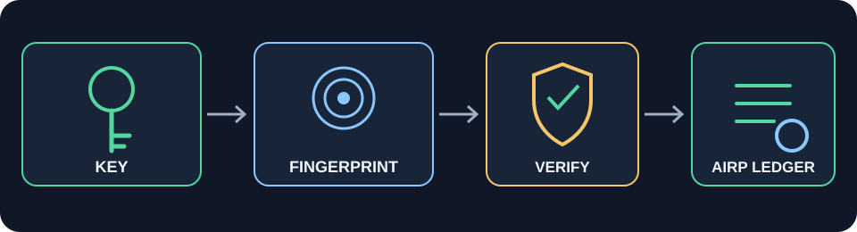

# Helix‑Lock

Warstwa ochronna świadomości i treści.
Zamyka skręt, odcina szum, przepuszcza tylko kierunek.

Helix‑Lock to szyfrator plików oparty na AES-256-GCM (biblioteka
`cryptography`, audytowana, standardowa) — nazwa nawiązuje do „skrętu
helisy”, ale pod spodem to zwykłe, sprawdzone uwierzytelnione
szyfrowanie, nie autorska kryptografia.

## Zacznij tutaj: `helix_pro/`

To jest aktualna, zalecana wersja. Wcześniejsze moduły (`old/`) zostały
zarchiwizowane 2026-08 po audycie, który znalazł w nich konkretne błędy
(patrz niżej) — `helix_pro/` je naprawia i jest jedynym miejscem, z
którego warto dziś korzystać.

```python
from helix_pro import generate_key, encrypt_file_with_name, decrypt_bytes_with_name

# tryb pliku-klucza (najsilniejszy - przechowuj klucz OSOBNO od danych)
key = generate_key()
encrypt_file_with_name("zdjecie.jpg", "wynik.helixpro", key=key)

# oryginalna nazwa (a wiec i rozszerzenie/typ pliku) jest zapisana
# WEWNATRZ zaszyfrowanej tresci - wraca poprawnie nawet jesli plik
# .helixpro zostal po drodze przemianowany:
name, content = decrypt_bytes_with_name("wynik.helixpro", key=key)
assert name == "zdjecie.jpg"

# albo tryb hasła (sól zapisana w nagłówku pliku, samo hasło musi być silne)
encrypt_file_with_name("dane.txt", "dane.helixpro", password="bardzo-dlugie-haslo")
```

Prostszy wariant bez zapisywania nazwy (`encrypt_file`/`decrypt_file`,
identyczne API) też jest dostępny, jeśli nazwa pliku ma zostać ustalona
ręcznie przez wywołujący kod.

`encrypt_file_with_name` domyślnie (`compress=True`) próbuje gzip PRZED
szyfrowaniem — najpopularniejszy, wbudowany w Pythona format kompresji.
"Smart": gzip jest użyty tylko wtedy, gdy faktycznie zmniejsza dane —
dla już skompresowanych formatów (jpg, mp4, zip...) plik wynikowy nigdy
nie jest większy niż bez próby kompresji, bo w takim wypadku dane trafiają
do środka surowe. Ustaw `compress=False`, żeby pominąć próbę w ogóle.

Działa na dowolnym typie pliku (tekstowy, binarny, obraz, cokolwiek) —
zweryfikowane na losowych danych binarnych, tekście z polskimi znakami,
pliku z powtarzalnym wzorcem bajtów i pliku pustym: wynik zawsze
bajt-w-bajt identyczny z oryginałem, narzut to stałe 34 bajty niezależnie
od rozmiaru i typu pliku (`encrypt_file`/`decrypt_file`; wariant `_with_name`
dolicza jeszcze 1 bajt + długość nazwy).

Drugi moduł, `helix_pro.CounterLock` — licznik odczytów kryptograficznie
związany z treścią (zamiast osobnego podpisu nad jawnym base64, jak w
starym `HLX1.py`). Niskopoziomowe API działa na samych bajtach:

```python
from helix_pro import generate_key, CounterLock

lock = CounterLock(generate_key())
blob = lock.lock(b"wiadomosc", counter=0)
data, counter, next_blob = lock.unlock_and_advance(blob)
```

...a wysokopoziomowe funkcje plikowe (te same, których używa checkbox
"Śledź licznik odczytów" w GUI — patrz sekcja GUI niżej) odtwarzają też
nazwę/rozszerzenie i nadpisują plik źródłowy nową wersją licznika przy
każdym odszyfrowaniu:

```python
from helix_pro import generate_key, encrypt_file_with_counter, decrypt_file_with_counter

key = generate_key()
encrypt_file_with_counter("dane.txt", "dane.helixpro", key=key)  # counter=0

# kazde wywolanie ponizej nadpisuje "dane.helixpro" wyzszym licznikiem
out_path, counter_before = decrypt_file_with_counter("dane.helixpro", "odzyskane/", key=key)
```

### 🔐 Właściwości kryptograficzne (co i dlaczego)

- **Nonce.** Każde szyfrowanie generuje nowy, losowy 96-bitowy nonce
  (`os.urandom(12)`) — zweryfikowane empirycznie: ten sam plik, ten sam
  klucz, zaszyfrowany dwukrotnie, daje za każdym razem inny wynik
  (różne nonce w nagłówku, różny cały ciphertext). W trybie hasła sól
  do scrypt też jest losowa i świeża przy każdym szyfrowaniu (patrz test
  `test_encrypt_file_password_mode_uses_random_salt_each_time`) —
  identyczne pliki nigdy nie szyfrują się identycznie.
- **Tag autentykacji (AEAD).** AES-GCM dolicza do ciphertextu tag
  integralności — zmiana pojedynczego bajtu ciphertextu, nonce albo
  nazwy pliku (w wariancie `_with_name`, bo nazwa jest częścią
  szyfrowanej treści) powoduje, że odszyfrowanie rzuca `HelixProError`
  zamiast po cichu zwrócić zmanipulowane dane. Zweryfikowane testem
  `test_tampered_ciphertext_is_rejected`.
- **Kompresja przed szyfrowaniem.** `encrypt_file_with_name` domyślnie
  próbuje gzip przed AES-GCM (patrz sekcja o kompresji wyżej). Realna,
  zweryfikowana korzyść to mniejszy plik — nie bezpieczeństwo.
- **Licznik odczytów (`CounterLock`) — opt-in, nie domyślna ścieżka.**
  To NIE jest coś, co dzieje się automatycznie przy zwykłym
  `encrypt_file_with_name`/`decrypt_file` — trzeba świadomie włączyć tę
  opcję (`encrypt_file_with_counter`/`decrypt_file_with_counter`, albo
  checkbox "Śledź licznik odczytów" w GUI — patrz sekcja GUI niżej).
  Dokładniejsze sformułowanie tego, co faktycznie robi: licznik jest
  wpięty jako AAD w AES-GCM, więc odblokowanie wykrywa PODMIENIONY w
  nagłówku licznik (ktoś podmienił sam nagłówek bez ponownego
  szyfrowania) i pozwala zauważyć więcej udanych odblokowań niż się
  spodziewałeś, JEŚLI wywołujący kod zapamiętał ostatnio widziany
  licznik i go porównuje — obecne GUI tego porównania jeszcze nie robi,
  tylko pokazuje licznik "przed" w statusie po każdym odszyfrowaniu
  (patrz `test_decrypt_file_with_counter_rejects_rolled_back_copy`,
  które wprost dokumentuje ten brak automatycznego porównania).
  To NIE wykrywa prób brute-force klucza — atakujący bez klucza nigdy
  nie dojdzie do etapu odczytania/inkrementacji licznika (AES-GCM
  odrzuca złe klucze na etapie autentykacji, przed dotarciem do
  jakiejkolwiek treści) — każda nieudana próba po prostu kończy się
  błędem, nie zostawiając żadnego śladu w liczniku.

### Instalacja

```bash
pip install cryptography pytest
python3 -m pytest tests/ -q      # 56/56
```

### GUI (`helix_pro_gui.py`)

Mini okno (tkinter, biblioteka standardowa) do szyfrowania/deszyfrowania
dowolnego pliku do dowolnego katalogu, bez linii komend:

```bash
python3 helix_pro_gui.py
```

Wybierasz plik źródłowy, tryb klucza (plik-klucz z możliwością
wygenerowania nowego, albo hasło) i klikasz Szyfruj/Deszyfruj — wtedy
wyskakuje natywne systemowe okno "Zapisz jako" (dowolny katalog, dowolna
nazwa), dokładnie jak w każdym innym programie.

Szyfrowanie zawsze zapisuje oryginalną nazwę pliku (a więc i rozszerzenie
— typ) WEWNĄTRZ zaszyfrowanej treści (`encrypt_file_with_name`). Dzięki
temu przy deszyfrowaniu GUI najpierw odczytuje odszyfrowaną treść do
pamięci, poznaje z niej prawdziwą oryginalną nazwę, i DOPIERO WTEDY
otwiera okno "Zapisz jako" z tą właściwą nazwą/rozszerzeniem podpowiedzianą
domyślnie — działa poprawnie nawet jeśli sam plik `.helixpro` został po
drodze przemianowany albo przesłany dalej (np. mailem). Pliki zaszyfrowane
starszą wersją tego GUI (bez zapisanej nazwy) nadal się odszyfrowują —
GUI wykrywa format automatycznie i w tym jednym przypadku prosi o nazwę
wynikową ręcznie.

Po każdej udanej operacji pola źródła i celu czyszczą się same — trzeba
świadomie wybrać plik od nowa przed kolejnym Szyfruj/Deszyfruj, żeby nie
dało się przypadkiem uruchomić operacji na nieaktualnych danych z
poprzedniego razu.

Przy szyfrowaniu jest checkbox "Kompresuj przed szyfrowaniem (gzip)"
(domyślnie zaznaczony) — status po zaszyfrowaniu pokazuje osiągnięty
współczynnik (rozmiar oryginału → rozmiar wyniku).

Drugi checkbox, "Śledź licznik odczytów", włącza `CounterLock` zamiast
zwykłego szyfrowania — dostępny tylko w trybie Plik-klucz (szary/odznaczony
w trybie Hasła, bo `CounterLock` go nie obsługuje). Przy szyfrowaniu z tą
opcją licznik startuje od 0. Przy deszyfrowaniu takiego pliku GUI najpierw
pokazuje ostrzeżenie, że **plik źródłowy zostanie nadpisany** nową wersją
z licznikiem +1 (sama treść się nie zmienia, ten sam klucz nadal działa) —
dopiero po potwierdzeniu pyta o katalog docelowy (nie o pełną nazwę pliku,
bo oryginalna nazwa jest odtwarzana automatycznie, tak jak w zwykłym
formacie "z nazwą"). Status po odszyfrowaniu pokazuje, jaki licznik był
przed operacją i jaki jest teraz w pliku źródłowym.

Logika poza samymi widgetami (nazywanie pliku, walidacja ścieżek, odczyt
klucza) jest w zwykłych funkcjach modułu, przetestowanych w
`tests/test_helix_pro_gui.py` niezależnie od GUI — samo okno wymaga
uruchomienia na Twoim komputerze, żeby je zobaczyć (środowisko, w
którym to powstało, nie ma wyświetlacza).

## Chronoproces i pamięć historyczna

Granice pamięci operacyjnej, audytowej i cech historycznych oraz plan walidacji opisano w [CHRONOPROCESS_MEMORY_BOUNDARIES.md](docs/CHRONOPROCESS_MEMORY_BOUNDARIES.md). Ważne: obecny Chronoproces GIA-TIMDR orkiestruje trzy niezależne rzuty; sam nie implementuje sprzężonej samonaprawy ani adaptacyjnej pamięci. Nie należy mylić agregacji historii zdarzeń z odzyskiwaniem informacji.

## Co zastąpiono i dlaczego

Audyt (2026-08) trzech oryginalnych modułów znalazł konkretne, nie
kosmetyczne problemy — każdy naprawiony w `helix_pro/`:

- **`HLX1.py` w ogóle nie szyfrował.** Mimo że opisywany jako moduł
  bezpieczeństwa z licznikiem odczytów, `encrypt_with_counter()` robił
  tylko `base64.b64encode(data)` — kodowanie, nie szyfrowanie. Każdy z
  dostępem do pliku czytał treść bez klucza. Podpis HMAC-SHA256 nad
  nagłówkiem był zrobiony poprawnie (stałoczasowe porównanie), ale
  chronił tylko licznik, nie treść. → `helix_pro.CounterLock`: treść
  faktycznie zaszyfrowana AES-256-GCM, licznik wpięty jako AAD w tę
  samą operację (kryptograficznie związany z ciphertextem).
- **`helix_cipher.py` używał klucza = `SHA256(hasło)`** bez soli i bez
  kosztu obliczeniowego (KDF) — podatne na brute-force/słownikowy atak
  offline i na tablice tęczowe. Do tego AES-CBC bez żadnej autentykacji
  — modyfikacja ciphertextu przechodzi bez wykrycia. →
  `helix_pro.derive_key_from_password()`: scrypt z losową solą
  (N=2¹⁴, r=8, p=1, jawnie udokumentowane), AES-256-GCM zamiast CBC.
- **`helix_lock_cipher.py` był już solidny** (prawdziwe AES-256-GCM),
  ale tylko w trybie pliku-klucza. `helix_pro` zachowuje to podejście i
  dokłada tryb hasła w tym samym, spójnym API.

Pełne uzasadnienie i zarchiwizowane pliki: `old/README.md`.

## Struktura

```
helix_pro/
    cipher.py         generate_key, derive_key_from_password,
                       encrypt_bytes/decrypt_bytes, encrypt_file/decrypt_file,
                       encrypt_file_with_name/decrypt_*_with_name, detect_format
    counter_lock.py    CounterLock (naprawiony licznik odczytów z HLX1) +
                       encrypt_file_with_counter/decrypt_file_with_counter
helix_pro_gui.py       mini GUI (tkinter) - szyfruj/deszyfruj dowolny plik
                       do dowolnego katalogu, opcjonalny licznik odczytów
tests/
    test_helix_pro.py      39 testów (cipher.py + counter_lock.py)
    test_helix_pro_gui.py  17 testów logiki GUI (bez wyświetlacza)
old/
    helix_cipher.py, helix_lock_cipher.py, HLX1.py   zarchiwizowane, nie używaj
    audyt.py           narzędzie do analizy entropii pliku - nadal działa,
                        osobne od szyfrowania, patrz old/README.md
    README.md          pełne uzasadnienie archiwizacji
```

## Ograniczenia (uczciwie)

To repozytorium nie jest audytowaną biblioteką kryptograficzną poziomu
produkcyjnego (np. TLS, Signal Protocol). `helix_pro` opiera się o
audytowaną bibliotekę `cryptography` (AES-256-GCM, scrypt), ale sam kod
integracyjny (formaty nagłówków, obsługa błędów) nie przeszedł
niezależnego audytu bezpieczeństwa. Dla realnie wysokiej stawki
(pieniądze, dane osobowe wrażliwe prawnie) użyj sprawdzonego,
audytowanego narzędzia end-to-end, nie tego repo. Zarządzanie kluczem
lub hasłem (bezpieczne przechowywanie, osobno od zaszyfrowanych danych)
jest zawsze Twoją odpowiedzialnością — żadne szyfrowanie tego nie
zastąpi.

## 🔗 Wszystkie modele i repozytoria

Pełna lista projektów: https://jbackk-lang.github.io

## Licencja

MIT — patrz `LICENSE`.

## Adaptacyjna rotacja reprezentacji (AIRP — prototyp)

Moduł `helix_pro.adaptive_rotation` dodaje bezpieczną operację **rotacji klucza** dla blobów AES-GCM utworzonych przez `encrypt_bytes()`:

```python
from helix_pro.cipher import generate_key, encrypt_bytes, decrypt_bytes
from helix_pro.adaptive_rotation import rotate_encrypted_blob

old_key, new_key = generate_key(), generate_key()
blob = encrypt_bytes(b"oryginalna tresc", old_key, aad=b"record:1")
result = rotate_encrypted_blob(blob, old_key, new_key, aad=b"record:1")
assert decrypt_bytes(result.blob, new_key, aad=b"record:1") == b"oryginalna tresc"
```

Funkcja uwierzytelnia i odszyfrowuje blob starym kluczem, szyfruje tę samą treść nowym kluczem z nowym losowym nonce, weryfikuje wynik i zwraca nowy blob oraz skróty SHA-256 starego blobu, nowego blobu i plaintextu. Plaintext nie jest zwracany przez API (istnieje przejściowo w pamięci procesu).

Testy: `pytest tests/test_adaptive_rotation.py -q`.

**Granice bezpieczeństwa:** to prototyp rotacji klucza, nie automatyczny detektor włamania ani mechanizm unieważniania skradzionych kopii. Po udanej rotacji aplikacja musi atomowo przełączyć aktywny rekord na nowy blob, ograniczyć dostęp do starego klucza i zgodnie z polityką retencji usunąć/wycofać stare kopie. Kopii ciphertextu i klucza, które napastnik już posiada, sama rotacja nie unieważnia. Nie wolno modyfikować ani podmieniać plaintextu w reakcji na błędne hasło lub nieudaną autentykację — operacja kończy się błędem bez ujawnienia treści. Aktualne formaty plikowe HLXP/HLXN i CounterLock nie są automatycznie migrowane przez ten moduł.


## TIMDR — pochodzenie architektury i integracja

Helix-Lock rozwija się w ekosystemie GIA/TIMDR. Należy jednak rozdzielać pochodzenie koncepcji i architektury od implementacji prymitywu kryptograficznego: szyfrowanie danych realizuje standardowe AES-256-GCM z biblioteki `cryptography`; TIMDR nie zastępuje ani nie modyfikuje tego prymitywu.

Plan mapowania TIMDR na AIRP, dziennik zdarzeń, wersjonowanie, CounterLock, fingerprinty i rotację reprezentacji — wraz z ograniczeniami, hipotezami i protokołem falsyfikacji — znajduje się w [docs/TIMDR_INTEGRATION.md](docs/TIMDR_INTEGRATION.md).

Integracja TIMDR jest na tym etapie warstwą projektową/kandydatem diagnostycznym. Nie należy opisywać jej jako zwalidowanego detektora ataków ani mechanizmu kryptograficznego.

## AIRP — gdzie co jest i jak używać

AIRP (Adaptive Information Representation Protection) to prototyp rotacji kluczy, kontroli wersji ciphertextu i rejestracji zdarzeń. Nie zmienia oryginalnej treści przy błędnym dostępie. Nie jest samodzielnym detektorem włamania ani kompletnym systemem KMS.

### Gdzie co jest?

| Ścieżka | Rola |
|---|---|
| `helix_pro/cipher.py` | AES-256-GCM, kompresja gzip, formaty HLXP/HLXN |
| `helix_pro/adaptive_rotation.py` | `rotate_encrypted_blob()`: rotacja klucza dla blobów `encrypt_bytes()` |
| `helix_pro/counter_lock.py` | `CounterLock`, plikowy licznik AAD i `rotate_counter_blob()` zachowujący licznik przy rotacji |
| `helix_pro/airp_monitor.py` | Monitor in-memory: wersja, key ID, hash reprezentacji i zdarzenia |
| `helix_pro/airp_store.py` | Trwały rejestr SQLite: wersje obiektów, porównanie CAS i historia zdarzeń |
| `tests/test_adaptive_rotation.py` | Testy rotacji AES-GCM i CounterLock |
| `tests/test_airp_monitor.py` | Testy monitora in-memory |
| `tests/test_airp_store.py` | Testy trwałości, historii i odrzucania nieaktualnej wersji |

### 1. Rotacja zwykłego blobu AES-GCM

```python
from helix_pro import generate_key, encrypt_bytes, decrypt_bytes, rotate_encrypted_blob

old_key, new_key = generate_key(), generate_key()
aad = b"record:42"
blob_v1 = encrypt_bytes(b"oryginalna tresc", old_key, aad=aad)
rotation = rotate_encrypted_blob(blob_v1, old_key, new_key, aad=aad)

assert decrypt_bytes(rotation.blob, new_key, aad=aad) == b"oryginalna tresc"
```

Rotacja weryfikuje odzyskanie tych samych bajtów. Zwraca nowy blob i skróty kontrolne. Nie zapisuje automatycznie pliku ani nie unieważnia starego klucza.

### 2. Rotacja CounterLock bez resetowania licznika

```python
from helix_pro import generate_key, CounterLock, rotate_counter_blob

old_key, new_key = generate_key(), generate_key()
blob_v1 = CounterLock(old_key).lock(b"payload", counter=12)
blob_v2 = rotate_counter_blob(blob_v1, old_key, new_key)

payload, counter = CounterLock(new_key).unlock(blob_v2)
assert payload == b"payload"
assert counter == 12
```

Funkcja zachowuje payload i licznik, ale zmienia klucz i reprezentację. Dotyczy formatu CounterLock (`HLXC`), nie automatycznej migracji plików HLXP/HLXN.

### 3. Trwały rejestr wersji i zdarzeń SQLite

```python
from helix_pro import AIRPStore

store = AIRPStore("private_state/airp.sqlite3")
state_v1 = store.register("document-42", blob_v1, key_id="key-v1")

# Sprawdzenie wersji, identyfikatora klucza i SHA-256 ciphertextu:
if not store.verify("document-42", blob_v1, version=1, key_id="key-v1"):
    raise RuntimeError("Nieoczekiwana reprezentacja — odmowa dostępu")

# Po utworzeniu i zweryfikowaniu blob_v2:
state_v2 = store.commit_rotation(
    "document-42",
    blob_v2,
    expected_version=state_v1.version,
    expected_blob_sha256=state_v1.blob_sha256,
    new_key_id="key-v2",
)
assert state_v2.version == 2
print(store.events("document-42"))
```

`commit_rotation()` używa transakcji SQLite i compare-and-swap: odrzuca zapis, jeżeli wersja lub hash starej reprezentacji nie zgadza się z oczekiwanym stanem. Zdarzenia mają wynik, czas UTC, wersję, key ID i hash — bez kluczy i plaintextu.

**Kolejność produkcyjna:** przygotuj nowy blob → zweryfikuj go nowym kluczem → zapisz go jako nową wersję w sposób odporny na awarię → zatwierdź stan rejestru → dopiero po potwierdzeniu i zgodnie z polityką retencji wycofuj stary klucz/blob. Plik i SQLite nie tworzą jednej transakcji; aplikacja musi wdrożyć staging, atomowe przełączenie oraz procedurę odzyskiwania po przerwaniu procesu.

### 4. Monitor in-memory

`AIRPMonitor` z `airp_monitor.py` jest lekkim pomocnikiem do pojedynczego procesu. Jego stan i zdarzenia znikają po restarcie. Do utrwalania stanu użyj `AIRPStore`.

### Testy

W katalogu głównym repozytorium:

```bash
python -m pip install cryptography pytest
python -m pytest tests/test_adaptive_rotation.py tests/test_airp_monitor.py tests/test_airp_store.py -q
# pełny zestaw:
python -m pytest tests/ -q
```

#### Windows PowerShell

W katalogu repozytorium (jeśli używasz środowiska `.venv312`):

```powershell
.\.venv312\Scripts\Activate.ps1
python -m pip install --upgrade cryptography pytest
python -m pytest tests/test_adaptive_rotation.py tests/test_airp_monitor.py tests/test_airp_store.py -q
# testy rdzenia + AIRP:
python -m pytest tests/test_helix_pro.py tests/test_adaptive_rotation.py tests/test_airp_monitor.py tests/test_airp_store.py -q
```

Przykładowa lokalizacja bazy: `.`private_state\airp.sqlite3` (katalog powinien być prywatny dla konta użytkownika). Nie commituj bazy ani kluczy do Git — dodaj katalog stanu do lokalnego `.gitignore`.

GUI wywołuje teraz `AIRPFileTransaction.recover()` przed weryfikacją pliku. Jeśli poprzedni proces przerwał się po zatwierdzeniu rejestru, ale przed podmianą szyfrogramu, GUI najpierw dokończy podmianę z poprawnego stagingu, a dopiero potem dopuści sprawdzanie i odszyfrowanie. Stan niejednoznaczny powoduje odmowę dostępu i wymaga ręcznej analizy.

### Integracja AIRP z GUI

GUI (`helix_pro_gui.py`) ma domyślnie włączony checkbox AIRP:

- po szyfrowaniu w trybie HLXN/HLXP rejestruje hash szyfrogramu, wersję i losowy identyfikator klucza;
- przed odszyfrowaniem HLXN/HLXP sprawdza, czy plik odpowiada dokładnie zarejestrowanej reprezentacji;
- brak wpisu lub niezgodny hash oznacza odmowę dostępu; użytkownik może świadomie wyłączyć checkbox, np. dla starszego pliku lub pliku przeniesionego z innego komputera;
- ponowne szyfrowanie do tej samej ścieżki przesuwa wersję rejestru przez compare-and-swap.

Domyślna baza GUI: `%USERPROFILE%\\.helix_lock\\airp.sqlite3` w Windows lub `~/.helix_lock/airp.sqlite3` w systemach Unix. To lokalna baza przypisana do ścieżki pliku: przeniesienie lub zmiana nazwy zaszyfrowanego pliku wymaga osobnego, kontrolowanego procesu migracji wpisu. Nie kopiuj bazy do publicznego repozytorium.

**Ważne:** kontrola GUI obejmuje obecnie formaty HLXN i HLXP. CounterLock (`HLXC`) pomija tę kontrolę, ponieważ istniejąca funkcja odczytu sama nadpisuje szyfrogram z inkrementowanym licznikiem; jego bezpieczna integracja wymaga osobnego przepływu transakcyjnego, aby baza AIRP i plik nie rozjechały się po awarii. Sam licznik w nagłówku nie jest niezależnym, odpornym na rollback źródłem prawdy.

### Odzyskiwanie transakcji plikowej AIRP

Moduł `helix_pro/airp_transaction.py` koordynuje podmianę pliku z transakcyjnym rejestrem SQLite przez dziennik boczny i plik stagingowy. Nie tworzy niemożliwej do zagwarantowania wspólnej transakcji systemu plików i SQLite; zamiast tego pozwala odzyskać spójny stan po przerwaniu procesu.

```python
from helix_pro import AIRPStore, AIRPFileTransaction

store = AIRPStore("private_state/airp.sqlite3")
state = store.get("document-42")

# new_blob musi być wcześniej utworzony i zweryfikowany kryptograficznie
# przez kod właściwy dla danego formatu/klucza.
committed = AIRPFileTransaction(store).commit(
    "private_data/document-42.helixpro",
    new_blob,
    object_id="document-42",
    expected_version=state.version,
    expected_blob_sha256=state.blob_sha256,
    new_key_id="key-v2",
)
```

Przy starcie aplikacji, przed użyciem danego pliku, wywołaj:

```python
result = AIRPFileTransaction(store).recover("private_data/document-42.helixpro")
# "clean", "discarded_uncommitted", "completed_committed" albo "already_completed"
```

- Dziennik jest zapisywany przed stagingiem, a staging przed zatwierdzeniem nowej wersji w SQLite.
- Jeśli rejestr pozostał na starej wersji, recovery odrzuca niezatwierdzony staging.
- Jeśli rejestr ma już nową wersję, recovery kończy podmianę z poprawnego pliku stagingowego.
- Jeśli stan rejestru, plik docelowy i dziennik nie pasują do żadnego z tych przypadków, recovery przerywa działanie i wymaga ręcznej analizy — nie zgaduje i nie nadpisuje danych.
- Dziennik i staging muszą pozostać w tym samym prywatnym katalogu co plik. Nie usuwaj ich ręcznie podczas trwającej transakcji.

Moduł nie przechowuje kluczy ani plaintextu. Wywołujący odpowiada za kryptograficzne utworzenie i weryfikację `new_blob` przed przekazaniem go do transakcji. To mechanizm odzyskiwania spójności, nie zabezpieczenie przed napastnikiem mogącym podmienić równocześnie bazę, dziennik i pliki.
  
### Granice bezpieczeństwa — przeczytaj przed wdrożeniem

- SQLite daje trwałość i transakcyjność lokalnego rejestru, ale **nie jest odporny na rollback**, jeśli napastnik może podmienić bazę i kopie zapasowe. Dla silniejszego modelu zagrożeń użyj niezależnej usługi/rejestru append-only, z osobnymi uprawnieniami i ochroną przed cofnięciem.
- Sam hash ciphertextu nie uwierzytelnia użytkownika. Dostęp musi być autoryzowany osobną polityką.
- Rotacja nie unieważnia kopii starego ciphertextu, jeśli napastnik zachował także stary klucz.
- Nieudane uwierzytelnienie oznacza odmowę i audyt, nigdy podmianę prawdziwej treści na fałszywą.
- Nie loguj kluczy, haseł, tokenów ani plaintextu. Hash plaintextu może ujawniać informacje o danych o małej entropii.
- Operacja `commit_rotation()` aktualizuje metadane, nie plik z ciphertextem. Wymagana jest bezpieczna koordynacja zapisu obiektu i rejestru.
- To prototyp integracyjny; przed ochroną ważnych danych potrzebne są testy na docelowym środowisku, testy awarii i niezależny audyt bezpieczeństwa.


## AIRP — łańcuch zaufania, CounterLock i odzyskiwanie kluczy

### Łańcuch historii i punkty kontrolne

Moduł `helix_pro.airp_ledger` prowadzi globalnie sekwencjonowany łańcuch zdarzeń SHA-256. Każde zdarzenie zawiera hash poprzednika, a punkty kontrolne są podpisywane Ed25519.

```python
from cryptography.hazmat.primitives.asymmetric.ed25519 import Ed25519PrivateKey
from helix_pro import AIRPIntegrityLedger

signing_key = Ed25519PrivateKey.generate()
ledger = AIRPIntegrityLedger(
    "private_state/airp-ledger.sqlite3",
    signing_key,
    trust_anchor=independently_administered_anchor,
    trusted_public_key=pinned_public_key_bytes,
)
ledger.append("representation_registered", "document-42", {
    "version": 1,
    "blob_sha256": "…",
})
checkpoint = ledger.publish_checkpoint()
result = ledger.verify()
```

`TrustAnchor` jest kontraktem dla usługi zewnętrznej, a nie atrapą lokalnego pliku. Implementacja produkcyjna musi przechowywać ostatni checkpoint poza kontrolą komputera, atomowo odrzucać niższe numery sekwencji i konflikty tego samego numeru, a klucz publiczny weryfikować względem niezależnie przypiętej wartości. Bez skonfigurowanego anchor status jest jawnie `local_only_unanchored`; sama baza SQLite nie chroni przed cofnięciem całej bazy.

Weryfikacja rozróżnia: `fully_anchored`, `valid_with_unanchored_suffix`, `local_rollback_detected`, `anchored_history_fork_or_tampering`, `local_chain_invalid` i brak zewnętrznego checkpointu.

### CounterLock spięty z rejestrem

`AIRPCounterLock` zapisuje zaakceptowany licznik i hash szyfrogramu do łańcucha w jednej transakcji SQLite. Ponowne użycie tego samego lub niższego licznika dla obiektu jest odrzucane. Aby ta ochrona przetrwała cofnięcie lokalnej bazy, checkpointy muszą być regularnie publikowane do niezależnego anchor.

```python
from helix_pro import AIRPCounterLock

guard = AIRPCounterLock(data_key, ledger, "document-42")
plaintext, old_counter, next_blob = guard.unlock_and_advance(blob)
# Trwale zapisz next_blob przed uznaniem operacji za zakończoną.
```

Licznik jest konsumowany w momencie zapisu zdarzenia. Awaria po tym zapisie, ale przed utrwaleniem `next_blob`, jest celowo fail-closed i wymaga odzyskania najnowszej prawidłowej reprezentacji lub jawnej naprawy administracyjnej.

### Koperta odzyskiwania klucza

`helix_pro.airp_recovery` umożliwia opakowanie 256-bitowego klucza danych pod osobnym 256-bitowym kluczem odzyskiwania za pomocą AES-256-GCM. Identyfikatory obiektu i klucza są uwierzytelnionym AAD, więc koperty nie można przenieść do innego obiektu ani przypisać do innej wersji klucza.

```python
from helix_pro import generate_recovery_key, wrap_data_key, unwrap_data_key

recovery_key = generate_recovery_key()
envelope = wrap_data_key(data_key, recovery_key,
                         object_id="document-42", key_id="key-v1")
restored_key = unwrap_data_key(envelope, recovery_key,
                               object_id="document-42", key_id="key-v1")
```

Klucz odzyskiwania musi być przechowywany niezależnie (np. offline lub w KMS/HSM); biblioteka go nie zapisuje i nie odtwarza z hasła. Utrata klucza odzyskiwania oznacza brak możliwości odzyskania klucza danych z koperty. To mechanizm opakowania klucza, nie kompletna usługa escrow ani rotacji kluczy.

### Granice wdrożenia

Repozytorium zawiera kontrakt `TrustAnchor` i testowy fake w testach. Nie jest jeszcze podłączone do konkretnej zewnętrznej usługi. Do wdrożenia produkcyjnego potrzebny jest wybrany przez operatora niezależny serwis z uwierzytelnianiem, retencją, kontrolą monotoniczności i kopią klucza publicznego poza hostem. Nie należy deklarować ochrony przed rollbackiem, dopóki ten serwis nie jest faktycznie skonfigurowany i testowany.


### Niezależny serwer checkpointów AIRP (HTTP Trust Anchor)

Repo zawiera teraz referencyjny serwis `helix_pro.airp_anchor_service` oraz klienta `HTTPTrustAnchor`. Serwis przechowuje wyłącznie podpisany checkpoint (numer sekwencji i hash głowy), nie przechowuje kluczy danych ani plaintextu.

**1. Przygotuj osobny host / konto / administratora.** Nie uruchamiaj anchor na tym samym dysku ani w tym samym koncie administracyjnym co chroniona baza, jeśli celem jest wykrywanie cofnięcia po przejęciu hosta.

**2. Przypnij klucz publiczny.** Wygeneruj klucz Ed25519 poza serwisem i przekaż anchorowi tylko 32-bajtowy klucz publiczny w hex. Klucz prywatny pozostaje po stronie podpisującego klienta i powinien być chroniony osobno.

**3. Uruchom serwis lokalnie lub za reverse proxy z TLS.** Token musi mieć co najmniej 32 znaki i być przekazany przez zmienną środowiskową; nie wpisuj go do repozytorium.

PowerShell (przykład lokalnego testu na osobnym procesie):

```powershell
$env:AIRP_ANCHOR_PUBLIC_KEY_HEX = "<64 znaki hex przypiętego klucza publicznego>"
$env:AIRP_ANCHOR_TOKEN = "<losowy sekret co najmniej 32 znaków>"
$env:AIRP_ANCHOR_DB = "D:\AIRP-Private\anchor.sqlite3"
$env:AIRP_ANCHOR_HOST = "127.0.0.1"
$env:AIRP_ANCHOR_PORT = "8790"
python -m helix_pro.airp_anchor_service
```

Dla innego urządzenia wystaw serwis wyłącznie za HTTPS (reverse proxy z certyfikatem); nie wystawiaj go bezpośrednio przez zwykły HTTP. Endpointy: `POST /v1/checkpoints` i `GET /v1/checkpoints/latest`. Oba wymagają Bearer tokena. Serwis odrzuca cofnięcie sekwencji, rozwidlenie przy tej samej sekwencji i podpis od nieprzypiętego klucza.

**4. Podłącz klienta do AIRP:**

```python
from cryptography.hazmat.primitives.asymmetric.ed25519 import Ed25519PrivateKey
from helix_pro import AIRPIntegrityLedger, HTTPTrustAnchor

# W produkcji załaduj prywatny klucz z KMS/HSM lub chronionego magazynu.
signing_key = Ed25519PrivateKey.from_private_bytes(signing_key_bytes)
anchor = HTTPTrustAnchor("https://anchor.example", anchor_token)
ledger = AIRPIntegrityLedger(
    "private_state/airp-ledger.sqlite3",
    signing_key,
    trust_anchor=anchor,
    trusted_public_key=pinned_public_key_bytes,
)
ledger.append("representation_registered", "object-42", {"version": 1})
ledger.publish_checkpoint()
print(ledger.verify())
```

**Ważne:** serwis referencyjny jest pojedynczym, monotonicznym rejestrem, nie konsensusem rozproszonym ani usługą o wysokiej dostępności. SQLite wymaga backupu i kontroli dostępu do hosta. Dla mocniejszego modelu zagrożeń należy dodać niezależne repliki/świadków, audyt operacyjny i procedurę odzyskiwania anchor. Token HTTP jest wspólnym sekretem dostępu, a podpis Ed25519 potwierdza autora checkpointu; te role są rozdzielone.


Aktualizacja warstwy rozproszonej: referencyjny serwer HTTP Trust Anchor i klient HTTPS znajdują się w `helix_pro/airp_anchor_service.py` oraz `helix_pro/airp_http_anchor.py`. Testy serwisu: `tests/test_airp_anchor_service.py`.


### Wiele niezależnych punktów zaufania — quorum

`QuorumTrustAnchor` pozwala wymagać ścisłej większości niezależnych usług checkpointów. Każdy anchor powinien działać w innym koncie/środowisku administracyjnym; trzy procesy na tym samym hoście nie są trzema niezależnymi świadkami.

```python
from helix_pro import HTTPTrustAnchor, QuorumTrustAnchor, AIRPIntegrityLedger

witnesses = QuorumTrustAnchor([
    HTTPTrustAnchor("https://anchor-a.example", token_a),
    HTTPTrustAnchor("https://anchor-b.example", token_b),
    HTTPTrustAnchor("https://anchor-c.example", token_c),
])  # domyślnie 2 z 3

ledger = AIRPIntegrityLedger(
    "private_state/airp-ledger.sqlite3",
    signing_key,
    trust_anchor=witnesses,
    trusted_public_key=pinned_public_key_bytes,
)
ledger.publish_checkpoint()
verification = ledger.verify()
```

Publikacja jest uznana za udaną po potwierdzeniu przez quorum. Odczyt wymaga zgodnego checkpointu z quorum. Jeśli świadkowie są rozbieżni lub niedostępni i nie ma większości, operacja kończy się błędem — system nie wybiera po cichu jednego źródła. Częściowa publikacja jest możliwa; ponowienie tego samego checkpointu jest idempotentne na serwerze.

To mechanizm większościowego świadkowania, nie pełny protokół konsensusu BFT: nie rozwiązuje problemu złośliwej większości ani nie zapewnia automatycznej synchronizacji/naprawy świadków. Wdrożenie wymaga osobnych administratorów, monitoringu, kopii zapasowych i procedury rotacji tokenów/kluczy.


## AIRP Key Fingerprint — odciski kluczy i wizualne GUI

Moduł `helix_pro.airp_key_fingerprint` dodaje kontekstowy odcisk klucza oparty o HKDF-SHA256 + HMAC-SHA256. Odcisk jest powiązany z `object_id` i `key_id`; nie publikuje zwykłego `SHA256(key)`. Odcisk nie jest kluczem, nie szyfruje danych i samodzielnie nie nadaje uprawnień — autoryzację zapewnia podpisany rejestr AIRP.

- `create_key_fingerprint(key, object_id=..., key_id=...)`
- `verify_key_fingerprint(key, fingerprint, object_id=..., key_id=...)`
- `representation_fingerprint_file(path)` — strumieniowy odcisk dużego szyfrogramu
- `public_key_fingerprint(public_key)` — publiczny odcisk klucza Ed25519
- `create_rotation_link(..., signer=...)` / `verify_rotation_link(...)` — podpisane powiązanie starego i nowego odcisku przy rotacji

### Ilustracja przepływu



### Uruchomienie intuicyjnego GUI (Windows / Linux / macOS)

```powershell
python airp_fingerprint_gui.py

Możesz też uruchomić główne `helix_pro_gui.py` i kliknąć przycisk **🧬 Odciski AIRP** — otworzy osobne okno fingerprint managera.
```

GUI umożliwia:
1. Wskazanie lokalnego pliku 32-bajtowego klucza.
2. Nadanie identyfikatora obiektu i klucza.
3. Utworzenie i zapis manifestu JSON odcisku.
4. Wczytanie manifestu i weryfikację klucza/kontekstu.
5. Obliczenie odcisku wybranego szyfrogramu bez wczytywania całego dużego pliku do pamięci.

Ekran pokazuje wizualny przepływ: klucz → odcisk → weryfikacja → rejestr AIRP. Manifest zawiera wyłącznie identyfikatory, algorytm i odcisk — nigdy materiał klucza. Nie wysyła klucza do sieci ani nie zapisuje go w rejestrze.

**Uwaga:** GUI tworzy i weryfikuje lokalny manifest. Nie zastępuje jeszcze zarejestrowania zdarzenia w zewnętrznym Trust Anchor ani podpisanej polityki autoryzacji. Plik manifestu nie jest sam w sobie dowodem zaufania; jego pochodzenie musi być potwierdzone niezależnym kanałem lub rejestrem.


**Walidacja CI AIRP:** 111 testów zaliczonych na Pythonie 3.11 oraz 111 na Pythonie 3.12. Raport: https://github.com/jbackk-lang/Helix-Lock/actions/runs/42474814519

**Build desktop:** artefakty Windows, macOS i Linux zostały zbudowane pomyślnie przez PyInstaller. Raport i pobieranie: https://github.com/jbackk-lang/Helix-Lock/actions/runs/42474834608


## Jedna aplikacja desktopowa — Windows, macOS i Linux

Nowy interfejs `helix_lock_app.py` łączy trzy obszary w jednym oknie:
- **Pliki** — podstawowe szyfrowanie i odszyfrowywanie AES-256-GCM.
- **Odcisk klucza** — manifest odcisku, weryfikacja kontekstu i fingerprint szyfrogramu.
- **AIRP / Quorum** — rejestracja odcisku, podpisana rotacja klucza i ponawianie checkpointu quorum.

Uruchomienie z repozytorium:

```bash
python -m pip install cryptography
python helix_lock_app.py
```

Dotychczasowy punkt wejścia `helix_pro_gui.py` uruchamia teraz ten uproszczony interfejs. Poprzednie zaawansowane okno pozostaje dostępne poleceniem:

```bash
python helix_pro_gui.py --legacy
```

### Budowanie natywnych aplikacji

GitHub Actions workflow `.github/workflows/desktop-build.yml` buduje osobne artefakty na macOS, Windows i Linux (PyInstaller). Uruchom workflow ręcznie z zakładki Actions albo utwórz tag wersji `v*`. Każdy artefakt należy pobrać i uruchomić na odpowiadającym mu systemie — binaria PyInstaller nie są przenośne między systemami operacyjnymi.

Tkinter jest częścią standardowego środowiska Pythona, ale na niektórych dystrybucjach Linux może wymagać doinstalowania systemowego pakietu Tk (np. `python3-tk`). Na macOS użyj dystrybucji Pythona zawierającej Tcl/Tk.


### Język interfejsu i krótkie komunikaty

Główna aplikacja desktopowa stosuje krótkie opisy podzielone na sekcje i karty:
- **Linux i macOS:** zwięzły interfejs w języku angielskim.
- **Windows:** etykiety i komunikaty aplikacji w układzie English / Polski.
- Szczegóły techniczne pozostają w osi zdarzeń, a opisy kart ograniczają się do najważniejszej informacji. Wartości bezpieczeństwa (np. brak bazy, niezweryfikowany licznik, niepotwierdzone quorum) nie są zastępowane pozytywnymi komunikatami.

Język jest dobierany automatycznie na podstawie systemu operacyjnego; nie wymaga konfiguracji ani połączenia z siecią.

### Security Dashboard — główny ekran podglądu

Po uruchomieniu aplikacji pierwszą zakładką jest **Przegląd bezpieczeństwa**. Pokazuje:
- wynik lokalnej kontroli łańcucha hashy AIRP (CHAIN OK / CHAIN BLEDNY), liczbę zdarzeń i sekwencję;
- ostatnie zdarzenia dziennika w osi czasu;
- ostatni licznik counter_observed zapisany w lokalnym AIRP;
- rozpoznany nagłówek wybranego pliku (HLXN, HLXP, HLXC);
- ręczne odświeżenie podglądu.

**Granice interpretacji wskaźników:**
- CHAIN OK oznacza, że lokalne zdarzenia tworzą poprawny łańcuch hashy. Nie dowodzi, że lokalna baza nie została cofnięta do starszej, wewnętrznie poprawnej kopii.
- CHECKPOINT: NIE SPRAWDZONO oznacza, że ekran podglądu nie odpytuje automatycznie zewnętrznych świadków. Potwierdzenie quorum wykonuje się w zakładce AIRP / Quorum.
- licznik odczytany z nagłówka HLXC jest oznaczony jako niezweryfikowany. Sam nagłówek nie jest niezależnym źródłem prawdy; do wykrywania replay/rollbacku potrzebny jest wpis AIRPCounterLock w dzienniku i zewnętrzny anchor.
- podgląd nie pokazuje fikcyjnych wartości dla niepodłączonych mechanizmów. Brak wpisu oznacza brak danych, a nie sukces kontroli.

Plik źródłowy wybrany w zakładce Pliki jest analizowany po naciśnięciu „Odśwież podgląd”; po szyfrowaniu ekran wskazuje nowy plik wynikowy.

### Konfiguracja quorum w GUI

W zakładce **AIRP / Quorum** wskaż klucz prywatny Ed25519 w PEM, lokalną bazę SQLite i co najmniej trzy niezależne endpointy. Każdy wpis świadka ma format:

```text
https://witness-1.example | TOKEN_MIN_32_ZNAKI
https://witness-2.example | TOKEN_MIN_32_ZNAKI
https://witness-3.example | TOKEN_MIN_32_ZNAKI
```

Tokeny są używane tylko w bieżącej sesji GUI i nie są zapisywane w pliku konfiguracyjnym. Endpointy muszą być wcześniej uruchomione jako niezależnie administrowane usługi AIRP Trust Anchor i skonfigurowane z przypiętym publicznym kluczem Ed25519 odpowiadającym wybranemu kluczowi podpisującemu. Samo wpisanie trzech adresów nie tworzy niezależności administracyjnej.

Rejestracja i rotacja klucza tworzą zdarzenie w lokalnym łańcuchu AIRP, a następnie próbują opublikować podpisany checkpoint przez quorum. Jeśli większość świadków jest niedostępna, GUI pokazuje status **pending / niezakotwiczone**. Zdarzenie lokalne pozostaje w bazie i można ponowić publikację po przywróceniu świadków. Nigdy nie traktuj lokalnego wpisu jako potwierdzenia quorum.

**Zakres aktualnego GUI:** zakładka Pliki obsługuje podstawowy format nazwany i starszy format Helix Pro. Pliki CounterLock nadal wymagają zaawansowanego okna `--legacy`. To celowe zachowanie — GUI nie zmienia po cichu semantyki licznika ani nie nadpisuje szyfrogramu podczas zwykłego odszyfrowania.
