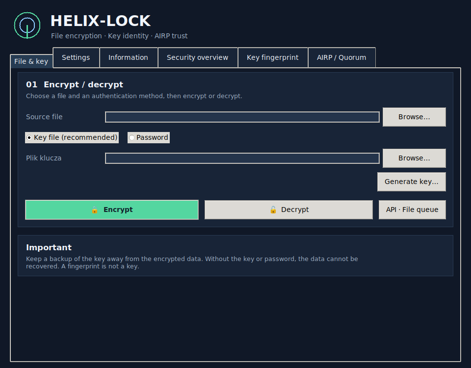

# Helix-Lock

### Twoje pliki. Twój klucz. Kontrola nad tym, co dzieje się z zaszyfrowanymi danymi.

Helix-Lock to desktopowe narzędzie do szyfrowania i odszyfrowywania plików. Łączy sprawdzone szyfrowanie **AES-256-GCM** z lokalną obsługą kluczy, identyfikacją kryptograficzną i dodatkowymi mechanizmami kontroli integralności.

Nie wymyślamy własnego algorytmu szyfrującego. Stawiamy na uznany standard i budujemy wokół niego praktyczne narzędzia do kontroli plików oraz kluczy.

## Co daje Helix-Lock?

- **Szyfrowanie dowolnych plików** — dokumentów, zdjęć, archiwów i danych binarnych.
- **Dwa sposoby uwierzytelnienia** — osobny plik-klucz lub hasło.
- **Odzyskiwanie oryginalnej nazwy** — nazwa i rozszerzenie są przechowywane wewnątrz zaszyfrowanej zawartości.
- **Rozsądna kompresja** — gzip jest używany tylko wtedy, gdy rzeczywiście zmniejsza plik.
- **Odciski kluczy i szyfrogramów** — manifest tożsamości klucza oraz obliczanie SHA-256 także dla dużych plików bez ładowania całości do RAM.
- **AIRP — historia integralności** — lokalny dziennik zdarzeń, kontrola łańcucha i możliwość zakotwiczenia stanu u niezależnych świadków.
- **CounterLock — licznik odczytów** — opcjonalny mechanizm Helix Pro/API wiążący licznik kryptograficznie z zaszyfrowaną treścią. Główna aplikacja pokazuje licznik odnotowany w AIRP; tryb CounterLock nie jest domyślną ścieżką szyfrowania w tym ekranie. To coś innego niż zwykły log aktywności; szczegóły i ograniczenia opisano w dokumentacji technicznej.

Najważniejszy przepływ jest prosty: **plik → klucz → szyfruj albo odszyfruj**. Ustawienia, informacje i narzędzia kontroli są dalej — nie przeszkadzają w podstawowej pracy.

## Co wyróżnia Helix-Lock?

Wiele komercyjnych narzędzi koncentruje się na sejfach, synchronizacji z chmurą, współdzieleniu plików lub zarządzaniu użytkownikami. Helix-Lock koncentruje się na pracy z pojedynczym plikiem i na dodatkowej kontroli jego kryptograficznej tożsamości.

| Produkt | Główny kierunek | Funkcje udokumentowane przez producenta |
|---|---|---|
| **Helix-Lock** | Lokalna praca z plikami i kluczami | AES-256-GCM, odciski kluczy i szyfrogramów, AIRP, opcjonalny CounterLock |
| [AxCrypt](https://axcrypt.net/features/) | Szyfrowanie plików i współpraca | AES-256, sejf, integracje z chmurą, bezpieczne udostępnianie, logi aktywności w planie Business |
| [Cryptomator](https://cryptomator.org/) | Szyfrowany sejf do przechowywania, także w chmurze | Szyfrowanie po stronie klienta, wirtualny dysk/sejf, integracja z usługami przechowywania |
| [NordLocker](https://nordlocker.com/features/) | Zaszyfrowana przestrzeń i chmura | Szyfrowanie end-to-end, synchronizacja, prywatne udostępnianie i przechowywanie w chmurze |

**Ważne rozróżnienie:** AxCrypt opisuje logi aktywności i śledzenie interakcji w ofercie biznesowej. CounterLock nie jest próbą zastąpienia takiego systemu audytowego — wiąże licznik z konkretnym zaszyfrowanym obiektem. Nie należy też traktować go jako DRM ani jako licznika nieudanych prób łamania hasła. Żaden z tych opisów nie oznacza, że Helix-Lock ma wszystkie funkcje platform chmurowych i zespołowych.

## Bezpieczeństwo bez marketingowych skrótów

- Szyfrowanie plików wykorzystuje AES-256-GCM z biblioteki `cryptography`.
- Tryb hasła używa scrypt z losową solą.
- Odcisk klucza nie ujawnia samego klucza.
- Lokalny dziennik AIRP pozwala wykrywać niespójność zapisanej historii; sam lokalny plik bazy nie chroni przed cofnięciem całej bazy.
- Ochrona przed takim cofnięciem wymaga niezależnego punktu zaufania lub quorum świadków.
- Licznik odczytów wymaga trwałego, niezależnego stanu, aby wiarygodnie wykrywać rollback. Nie jest automatycznym dowodem, kto otworzył plik.

Helix-Lock jest rozwijany z naciskiem na produktywność, ale bezpieczeństwo ma pierwszeństwo, gdy dodatkowa funkcja mogłaby je osłabić.

## Status projektu

**Build Windows / macOS / Linux: OK** · **Automatyczne CI: 122/122**

Aplikacja została zbudowana w CI dla Windows, macOS i Linux. Automatyczne testy przeszły na Pythonie 3.11 i 3.12. To potwierdza testy i proces budowania — **nie zastępuje ręcznych testów uruchomienia na rzeczywistych komputerach, niezależnego audytu ani podpisania instalatorów**. Paczki CI są niepodpisane. Projekt pozostaje w fazie rozwoju; nie przedstawiamy go jako certyfikowanego produktu bezpieczeństwa.

## Dokumentacja i kod

- **[Szczegóły techniczne v.0.1.1](docs/Szczegóły%20techniczne%20v.0.1.1.md)** — architektura, formaty, API, CounterLock, AIRP, testy, ograniczenia i instrukcje budowania.
- **[README 0.1 — archiwum pierwszej wersji](README_0.1.md)** — historyczny opis pierwotnego projektu.
- [Kod źródłowy](https://github.com/jbackk-lang/Helix-Lock/tree/experiment/helix-native)
- [Wyniki testów](https://github.com/jbackk-lang/Helix-Lock/actions/runs/42546705983)
- [Buildy dla trzech systemów](https://github.com/jbackk-lang/Helix-Lock/actions/runs/42546762025)

---

**Helix-Lock — szyfruj pliki. Zachowaj kontrolę nad kluczami. Weryfikuj historię.**
