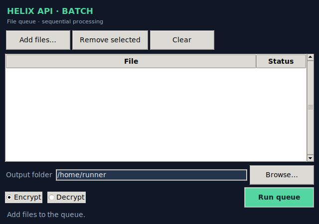

# Helix-Lock

> **OTWARTE TESTY BETA — WERSJA TESTOWA.** Helix-Lock jest udostępniany do praktycznych testów użytkowników; nie jest wydaniem stabilnym ani produkcyjnym i nie przeszedł niezależnego audytu bezpieczeństwa. Testuj wyłącznie na kopiach plików i zachowaj niezależne kopie zapasowe. Zgłaszaj błędy, problemy ze zgodnością i niejasności obsługi.

### Twoje pliki. Twój klucz. Kontrola nad tym, co dzieje się z zaszyfrowanymi danymi.

Helix-Lock pomaga kontrolować cały obieg zaszyfrowanego pliku — od przygotowania i przetwarzania wielu plików, przez identyfikację i weryfikację, po historię operacji. Łączy szyfrowanie **AES-256-GCM** z funkcjami, których zwykle trzeba szukać w kilku osobnych narzędziach: kolejką plików, odzyskiwaniem oryginalnych nazw, inteligentną kompresją, odciskami kryptograficznymi, historią integralności AIRP i opcjonalnym licznikiem odczytów CounterLock.

Podstawą poufności i integralności jest uznany standard AES-256-GCM z biblioteki `cryptography`. Wyróżnikiem Helix-Lock jest warstwa kontroli i obsługi danych wokół tego standardu — nie autorski algorytm szyfrujący.

## Pobierz wersję beta

Gotowe pakiety są dostępne bezpośrednio w oficjalnym GitHub Release:

- [Windows x64 — HelixLock-windows.zip](https://github.com/jbackk-lang/Helix-Lock/releases/download/v0.1.1-beta.2/HelixLock-windows.zip)
- [macOS — HelixLock-macos.zip](https://github.com/jbackk-lang/Helix-Lock/releases/download/v0.1.1-beta.2/HelixLock-macos.zip)
- [Linux — HelixLock-linux.tar.gz](https://github.com/jbackk-lang/Helix-Lock/releases/download/v0.1.1-beta.2/HelixLock-linux.tar.gz)
- [Sumy SHA-256](https://github.com/jbackk-lang/Helix-Lock/releases/download/v0.1.1-beta.2/SHA256SUMS-builds.txt)
- [Strona wydania v0.1.1 Beta 1](https://github.com/jbackk-lang/Helix-Lock/releases/tag/v0.1.1-beta.2)

To publiczna wersja beta przeznaczona do praktycznych testów. Nie jest stabilnym wydaniem produkcyjnym ani niezależnym audytem bezpieczeństwa. Windows może wyświetlić ostrzeżenie SmartScreen, ponieważ aplikacja nie ma jeszcze certyfikatu podpisu kodu. Pobieraj wyłącznie z oficjalnego wydania i sprawdzaj sumę SHA-256. Testuj wyłącznie na kopiach plików i zachowaj niezależne kopie zapasowe.

## Dwa kierunki rozwoju

Rozwój został rozdzielony na dwie gałęzie:

- **Helix File** — ta gałąź: aplikacja desktopowa, szyfrowanie plików, HLXN/HLXP, AIRP i kolejka plików.
- **Helix Stream** — [osobna gałąź eksperymentalna](https://github.com/jbackk-lang/Helix-Lock/tree/feature/helix-stream-core), przeznaczona do szyfrowania komunikatów i danych w locie.

Helix Stream ma własny [README](https://github.com/jbackk-lang/Helix-Lock/blob/feature/helix-stream-core/README.md) i [plan rozwoju](https://github.com/jbackk-lang/Helix-Lock/blob/feature/helix-stream-core/docs/HELIX_STREAM_ROADMAP.md). Zmiany Stream nie są automatycznie włączane do tej gałęzi ani do `main`.

## Co daje Helix-Lock?

- **Szyfrowanie dowolnych plików** — dokumentów, zdjęć, archiwów i danych binarnych.
- **API · Batch / kolejka plików** — małe, prostokątne okno zajmujące maksymalnie 1/4 powierzchni ekranu; dodawanie wielu plików, wybór katalogu wynikowego, szyfrowanie lub odszyfrowywanie sekwencyjne i status każdego elementu. Istniejące wyniki nie są nadpisywane automatycznie; nieobsługiwany CounterLock i nieznane formaty są pomijane.
- **Dwa sposoby uwierzytelnienia** — osobny plik-klucz lub hasło.
- **Odzyskiwanie oryginalnej nazwy** — nazwa i rozszerzenie są przechowywane wewnątrz zaszyfrowanej zawartości.
- **Rozsądna kompresja** — gzip jest używany tylko wtedy, gdy rzeczywiście zmniejsza plik.
- **Odciski kluczy i szyfrogramów** — manifest tożsamości klucza oraz obliczanie SHA-256 także dla dużych plików bez ładowania całości do RAM.
- **AIRP — historia integralności** — lokalny dziennik zdarzeń, kontrola łańcucha i możliwość zakotwiczenia stanu u niezależnych świadków.
- **CounterLock — licznik odczytów** — opcjonalny mechanizm Helix Pro/API wiążący licznik kryptograficznie z zaszyfrowaną treścią. Główna aplikacja pokazuje licznik odnotowany w AIRP; tryb CounterLock nie jest domyślną ścieżką szyfrowania w tym ekranie. To coś innego niż zwykły log aktywności; szczegóły i ograniczenia opisano w dokumentacji technicznej.

Najważniejszy przepływ jest prosty: **plik → klucz → szyfruj albo odszyfruj**. Gdy pracujesz z większą liczbą plików, otwórz **API · Lista plików** i przetwarzaj je kolejką bez zasłaniania głównego ekranu.

## Inteligentne właściwości Helixa

Helix nie ogranicza się do wykonania polecenia „zaszyfruj”. Rozpoznaje kontekst pliku i dobiera bezpieczną ścieżkę działania na podstawie jawnych reguł:

- **Rozpoznawanie formatu** — przed deszyfrowaniem identyfikuje nagłówek HLXP, HLXN lub CounterLock; nie próbuje odszyfrowywać nieznanego formatu na ślepo.
- **Inteligentna kompresja** — próbuje gzip, ale zachowuje dane bez kompresji, jeśli wynik nie jest mniejszy. Nie pogarsza rozmiaru plików już skompresowanych.
- **Pamięć oryginalnej nazwy** — HLXN przenosi nazwę i rozszerzenie wewnątrz uwierzytelnionego szyfrogramu, dzięki czemu plik można odtworzyć po zmianie nazwy samego kontenera.
- **Tożsamość zamiast samej nazwy** — odciski SHA-256 klucza i reprezentacji pliku pozwalają porównywać kryptograficzną tożsamość niezależnie od nazwy pliku.
- **Historia i kontrola spójności** — AIRP łączy zdarzenia w lokalny łańcuch, wykrywa niespójności i może korzystać z niezależnych punktów zaufania oraz quorum.
- **Licznik powiązany z obiektem** — CounterLock wiąże licznik z zaszyfrowaną treścią; jego wiarygodna kontrola wymaga trwałego, niezależnego stanu.
- **Przetwarzanie wsadowe** — kolejka API wykonuje operacje plik po pliku, pokazuje postęp i rozdziela wyniki udane, błędne oraz pominięte. Nie nadpisuje istniejących plików wynikowych.

To „inteligencja” oparta na weryfikowalnych regułach, metadanych i historii — nie deklaracja, że aplikacja używa modelu AI. Funkcje badawcze związane z sygnałem, fazą i pamięcią nie są elementem gwarancji bezpieczeństwa szyfrowania.

**Granica obecnej kolejki:** to lokalne okno batch/API, a nie uruchomiony serwer HTTP ani zdalny endpoint sieciowy. Przetwarzanie jest sekwencyjne. Obecna implementacja formatów HLXN/HLXP wczytuje zawartość pojedynczego pliku do pamięci, więc kolejka nie oznacza jeszcze strumieniowego szyfrowania bardzo dużych plików. CounterLock wymaga osobnej ścieżki z trwałym rejestrem i jest w kolejce pomijany.

## Co wyróżnia Helix-Lock?

Wiele komercyjnych narzędzi koncentruje się na sejfach, synchronizacji z chmurą, współdzieleniu plików lub zarządzaniu użytkownikami. Helix-Lock koncentruje się na pracy z pojedynczym plikiem i na dodatkowej kontroli jego kryptograficznej tożsamości.

| Produkt | Główny kierunek | Funkcje udokumentowane przez producenta |
|---|---|---|
| **Helix-Lock** | Lokalna praca z plikami i kluczami | AES-256-GCM, odciski kluczy i szyfrogramów, AIRP, opcjonalny CounterLock |
| [AxCrypt](https://axcrypt.net/features/) | Szyfrowanie plików i współpraca | AES-256, sejf, integracje z chmurą, bezpieczne udostępnianie, logi aktywności w planie Business |
| [Cryptomator](https://cryptomator.org/) | Szyfrowany sejf do przechowywania, także w chmurze | Szyfrowanie po stronie klienta, wirtualny dysk/sejf, integracja z usługami przechowywania |
| [NordLocker](https://nordlocker.com/features/) | Zaszyfrowana przestrzeń i chmura | Szyfrowanie end-to-end, synchronizacja, prywatne udostępnianie i przechowywanie w chmurze |

**Ważne rozróżnienie:** AxCrypt opisuje logi aktywności i śledzenie interakcji w ofercie biznesowej. CounterLock nie jest próbą zastąpienia takiego systemu audytowego — wiąże licznik z konkretnym zaszyfrowanym obiektem. Nie należy też traktować go jako DRM ani jako licznika nieudanych prób łamania hasła. Żaden z tych opisów nie oznacza, że Helix-Lock ma wszystkie funkcje platform chmurowych i zespołowych.

## Bezpieczeństwo bez marketingowych skrótów

- Szyfrowanie plików wykorzystuje AES-256-GCM z biblioteki `cryptography`.
- Tryb hasła używa scrypt z losową solą.
- Odcisk klucza nie ujawnia samego klucza.
- Lokalny dziennik AIRP pozwala wykrywać niespójność zapisanej historii; sam lokalny plik bazy nie chroni przed cofnięciem całej bazy.
- Ochrona przed takim cofnięciem wymaga niezależnego punktu zaufania lub quorum świadków.
- Licznik odczytów wymaga trwałego, niezależnego stanu, aby wiarygodnie wykrywać rollback. Nie jest automatycznym dowodem, kto otworzył plik.

Helix-Lock jest rozwijany z naciskiem na produktywność, ale bezpieczeństwo ma pierwszeństwo, gdy dodatkowa funkcja mogłaby je osłabić.

## Status projektu — BETA TEST

**Aktualny etap: przygotowanie do zamkniętych testów beta. Nabór testerów i dystrybucja bety nie zostały jeszcze uruchomione. Nie jest to wydanie stabilne ani certyfikowane.**

**Build Windows / macOS / Linux: OK** · **Automatyczne CI: 122/122**

Aplikacja została zbudowana w CI dla Windows, macOS i Linux. Automatyczne testy przeszły na Pythonie 3.11 i 3.12. To potwierdza testy i proces budowania — **nie zastępuje ręcznych testów uruchomienia na rzeczywistych komputerach, niezależnego audytu ani podpisania instalatorów**. Paczki CI są niepodpisane. Projekt pozostaje w fazie rozwoju; nie przedstawiamy go jako certyfikowanego produktu bezpieczeństwa.

## Testy beta i zgłaszanie błędów

Helix-Lock jest na etapie przygotowania do zamkniętej bety. Zewnętrzne testy beta nie zostały jeszcze uruchomione. Jeśli uczestniczysz w testach, korzystaj wyłącznie z kopii danych i zachowaj niezależną kopię zapasową.

- [Plan niezależnych testów beta](docs/BETA_TEST_PLAN_v0.1.1.md)
- [Zgłoszenie błędu beta](https://github.com/jbackk-lang/Helix-Lock/issues/new?template=bug_report.yml) — formularz wymaga wersji, systemu, kroków reprodukcji i potwierdzenia bezpiecznego testowania.
- [Polityka zgłaszania luk bezpieczeństwa](SECURITY.md) — nie publikuj szczegółów podatności w zwykłym zgłoszeniu.

## Dokumentacja i kod

- **[Szczegóły techniczne v.0.1.1](docs/Szczegóły%20techniczne%20v.0.1.1.md)** — architektura, formaty, API, CounterLock, AIRP, testy, ograniczenia i instrukcje budowania.
- **[README 0.1 — archiwum pierwszej wersji](README_0.1.md)** — historyczny opis pierwotnego projektu.
- [Kod źródłowy](https://github.com/jbackk-lang/Helix-Lock/tree/experiment/helix-native)
- [Wyniki testów](https://github.com/jbackk-lang/Helix-Lock/actions/runs/42546705983)
- [Buildy dla trzech systemów](https://github.com/jbackk-lang/Helix-Lock/actions/runs/42546762025)

---

**Helix-Lock — szyfruj pliki. Zachowaj kontrolę nad kluczami. Weryfikuj historię.**
